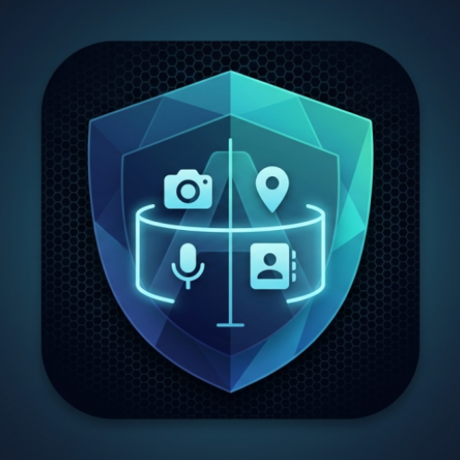
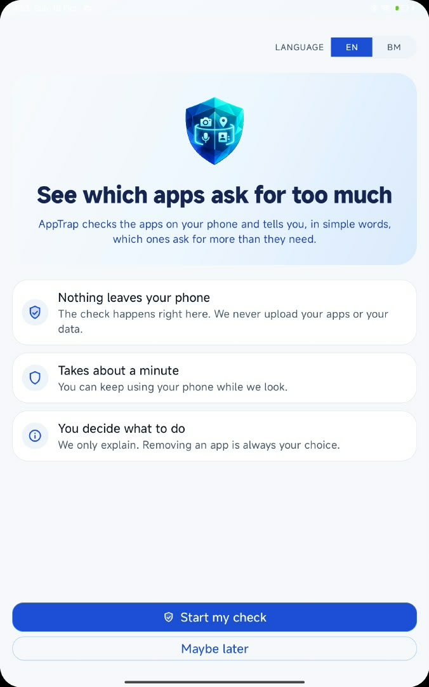
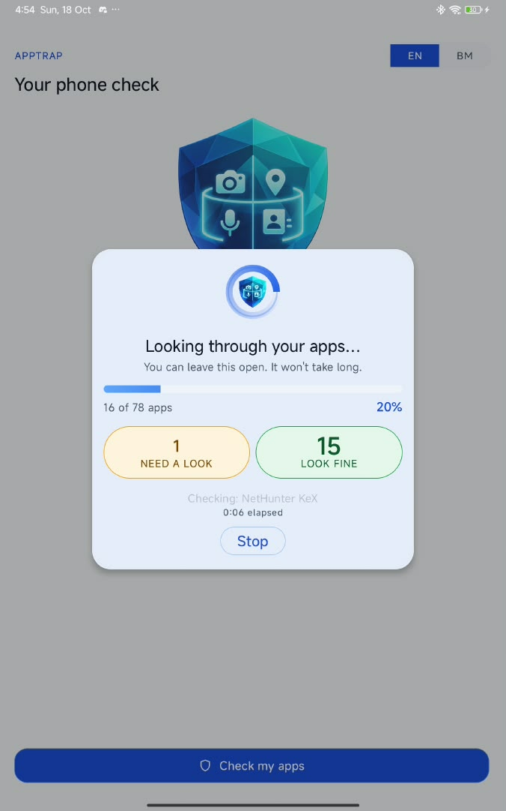
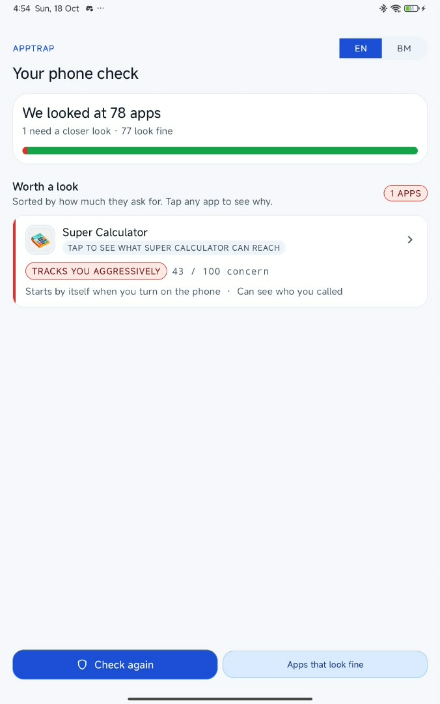
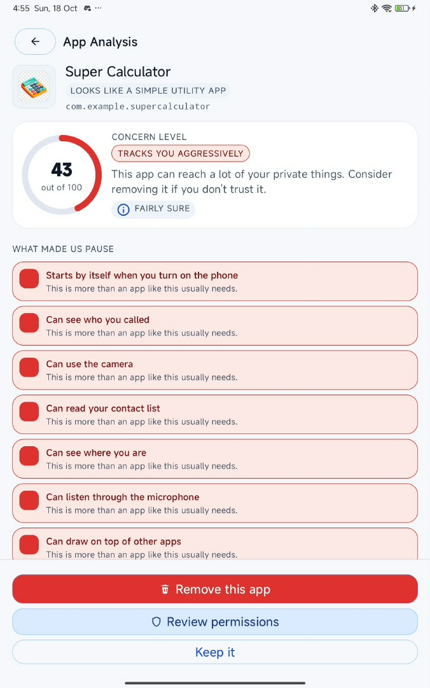
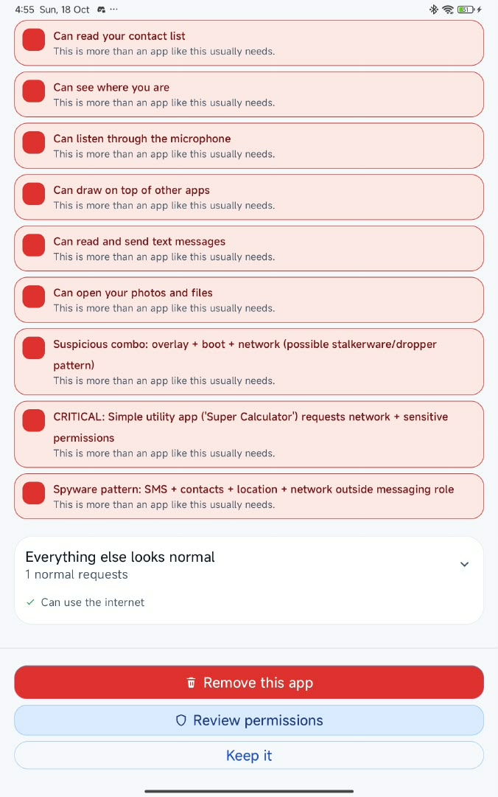
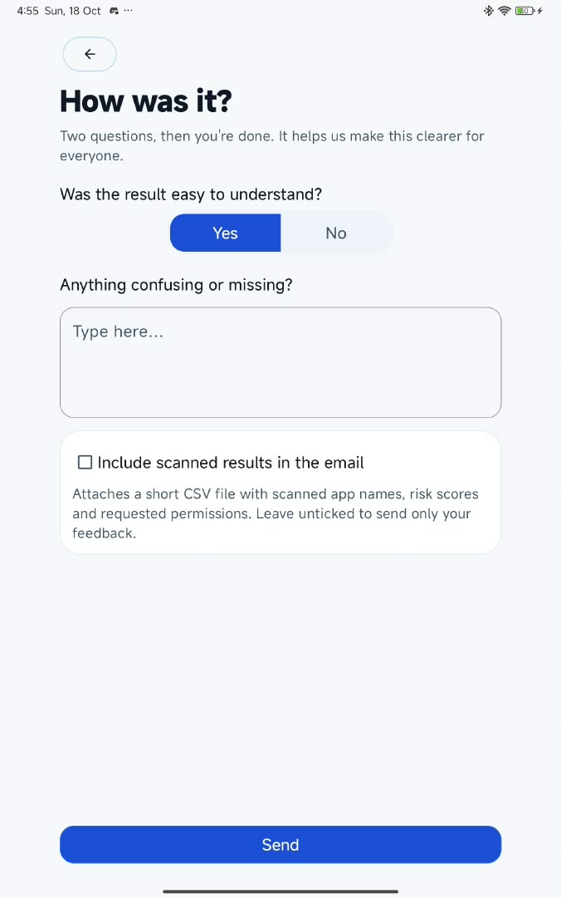

<p align="center">
  
</p>

# AppTrap — Android Privacy Analyzer

AppTrap helps Android users understand whether installed apps request permissions that fit their purpose. It combines a bundled app dataset, online permission research, a k-nearest-neighbors classifier, and permission-combination rules, then explains the results in English or Bahasa Malaysia.

This repository contains the latest **ApptrapLight** source: a light Material interface, guided app review, and optional scan-result sharing through an email draft. It is an academic Final Year Project (FYP) for a Diploma in Cybersecurity.

## Interface

Screenshots supplied on 18 October 2026 show the app running on an Android tablet. Counts and scores are examples from that device, not benchmark results.

| Start a check | Scan progress | Results |
| --- | --- | --- |
|  |  |  |

| App analysis | Review or remove | Feedback |
| --- | --- | --- |
|  |  |  |

[View all 15 screenshots and captions](docs/screenshots/README.md).

## What changed in this update

- Light theme with the shield artwork, refreshed colors, onboarding, scan animation, and result layout. `ApptrapApp` explicitly selects light mode.
- Results now focus on **Check again** and **Apps that look fine**. The standalone **Save a copy** and feedback buttons have been removed.
- App Analysis offers **Remove this app**, **Review permissions**, and **Keep it**. Review permissions opens the selected app's Android App info screen; removal guidance also opens App info and leaves uninstall confirmation to Android.
- The separate requested-permissions section has been removed from App Analysis; plain-language signal explanations remain.
- Feedback is available from the Back/exit prompt. A new guide explains how to review and send the email draft.
- **Include scanned results in the email** is optional and unchecked by default. Selecting it attaches a five-column CSV through a restricted cache FileProvider.
- Feedback layouts constrain content width for tablets; English and Malay strings cover the updated flows.

## Features and usage

1. Launch AppTrap, choose **EN** or **BM**, and complete the first-run introduction.
2. Start a check. AppTrap scans installed non-system apps, excluding updated system apps, and shows progress. Scanning can be stopped.
3. Review the summary and up to ten highest-scoring apps under **Worth a look**. Open an app to see its score, confidence, and permission explanations.
4. Use **Review permissions** to inspect its settings, **Remove this app** for removal guidance, or **Keep it** to return. AppTrap does not silently uninstall apps or revoke permissions.
5. Open **Apps that look fine** to review apps with a zero severity score, or run another check.
6. Press Back to use the exit feedback prompt. Choose **Tell us what you think**, answer the questions, and optionally include scan results. Continue to an email app, review the draft and attachment, and send it yourself.

A zero score means the current rules found no concern; it does not establish that an app is safe. High scores flag permission patterns for review and are not proof of tracking, malware, or malicious intent.

## Analysis pipeline

The implementation lives in `TrustEngine.kt`:

1. Look up the package in the bundled dataset.
2. If needed, try `ResearchEngine`: Google Play permission lookup, then Exodus Privacy, then a package-name heuristic.
3. Use display-name role inference, k-NN (Jaccard similarity, k=5), and finally a generic baseline when earlier sources are insufficient.
4. Normalize manifest-declared permissions into capability groups. This happens before classification because k-NN consumes those capabilities.
5. Compare observed capabilities with the expected baseline and apply capability weights.
6. Apply source/confidence adjustments and severity ceilings.
7. Evaluate six cross-permission rules, with role exemptions and OEM package-prefix handling.
8. Produce a `TrustVerdict` containing the role, baseline source, confidence, signals, severity, and technical label.

Unknown roles skip per-capability penalties and rely on combination rules. OEM handling uses package prefixes, not certificate verification. Permissions are requested manifest permissions, not a measurement of actual data access or current runtime grants.

| Severity | Engine label | English interface label |
| --- | --- | --- |
| 0 | `CONSISTENT` | Looks fine |
| 1–10 | `OVERREACH` | Asks for extra |
| 11–25 | `DECEPTIVE` | Doesn't add up |
| 26–100 | `SPYWARE-LIKE` | Tracks you aggressively |

The score is a heuristic concern score, not a probability. Online availability, stale datasets, inferred app roles, and broad exemptions can affect results. The Google Play integration uses an unofficial endpoint that may change.

## Dataset

The active file is [`app/src/main/assets/dataset_final.csv`](app/src/main/assets/dataset_final.csv): **2,306 rows, 2,306 unique package names, and 16 roles**, counted from this source snapshot. `AppDataset` loads package name, app name, role, expected capabilities, and source. Tracker metadata columns are present but are not used by the analyzer.

Other CSV files in `assets/` are retained source datasets; they are not the active baseline loaded by `AppDataset`. Dataset size and coverage should not be read as independently verified detection accuracy.

## Privacy and feedback

- Analysis runs on the device, but research lookups can send app package identifiers to Google Play and Exodus Privacy. The current onboarding text says that nothing leaves the phone; that wording is broader than the implemented network behavior.
- `TrustLog` records local analysis traces for debugging and academic review.
- Feedback opens an editable email draft addressed to the configured project feedback recipient. The body includes the feedback answer, written message, timestamp, app version, Android version, and device manufacturer/model.
- Scan details are excluded unless the checkbox is selected. When selected, the attachment contains **app name, package name, assessment, risk score, and requested permissions** for every scanned app, sorted by severity.
- The CSV is created under the app's `cacheDir/feedback_exports` directory and shared with temporary read permission. The app cannot confirm email delivery; the user must send from their email client.
- The manifest declares internet/network-state access, broad package visibility, and legacy external-storage permission up to API 28. The broad package-visibility declaration is marked for testing in the source.

## Build and run

### Project requirements

| Setting | Repository value |
| --- | --- |
| Android Gradle Plugin | 9.0.0 |
| Gradle wrapper | 9.1.0, with distribution checksum |
| Compile / target SDK | 36 |
| Minimum Android version | API 26 (Android 8.0) |
| Java source / target compatibility | 11 |
| Application ID | `com.example.androidprivacyanalyzer` |
| Version | `1.0` (`versionCode = 1`) |

Use Android Studio with support for AGP 9.0, a compatible Gradle JDK (JDK 17 or newer), and Android SDK Platform 36. Java 11 in the module configuration is the source compatibility level, not the Gradle runtime requirement.

```sh
git clone https://github.com/adumppp/AppTrap.git
cd AppTrap
```

Open the root folder in Android Studio, select the Gradle JDK, configure the local SDK location, and sync. Connect an Android 8.0+ device with USB debugging enabled, then run the `app` configuration. A device with installed third-party apps gives a more representative scan than a fresh emulator.

On Windows:

```powershell
.\gradlew.bat assembleDebug testDebugUnitTest lintDebug
```

On macOS/Linux:

```sh
chmod +x gradlew
./gradlew assembleDebug testDebugUnitTest lintDebug
```

The debug APK is generated at `app/build/outputs/apk/debug/app-debug.apk`. Build output, signing material, SDK paths, and local IDE state are excluded from version control. This source update does not publish an APK or a signed release.

### Verification and manual checks

Verified on 20 October 2026: `assembleDebug`, `testDebugUnitTest`, and `lintDebug` pass. The existing unit suite contains one passing test. Lint reports no errors and 83 warnings; these warnings remain for future cleanup. No device instrumentation or interactive device checks were run for this update.

The existing unit and instrumentation tests are template smoke tests; they do not validate detection accuracy. Device checks should cover EN/BM switching, start/cancel/rescan, result navigation, App info actions, exit feedback, and email drafts with the attachment option both off and on. Instrumentation checks require a connected device or emulator (`connectedDebugAndroidTest`).

If Android Studio's layout preview differs from runtime, select the light theme and check preview-only `tools:` visibility. The Application class and scan state are not executed by a static layout preview.

## Source map

| Path | Purpose |
| --- | --- |
| `app/src/main/java/com/example/androidprivacyanalyzer/TrustEngine.kt` | Baseline resolution, scoring, and verdicts |
| `ResearchEngine.kt`, `SimpleML.kt`, `AppDataset.kt` in the same directory | Online lookups, classifier, dataset loading |
| `MainActivity.kt`, `DetailActivity.kt`, `ConsistentAppsActivity.kt` | Scanning, per-app analysis, zero-score app list |
| `FeedbackActivity.kt`, `OnboardingActivity.kt`, `ApptrapApp.kt` | Feedback/CSV sharing, introduction, application theme |
| `app/src/main/java/com/example/androidprivacyanalyzer/ui/` | Adapters, plain-language signals, dialogs, animation, language toggle |
| `app/src/main/res/` | Android Views layouts, artwork, themes, English and Malay resources |
| `app/src/main/assets/` | Bundled baseline and supporting datasets |
| `docs/screenshots/` | Supplied UI screenshots and gallery |

The UI uses Android Views, Material components, RecyclerView, Kotlin coroutines, and a scan executor. It does not use Jetpack Compose.

## Team and academic context

| Team member | Contribution |
| --- | --- |
| Adam | Software logic, TrustEngine, ML integration, ResearchEngine |
| Izz | UI/UX, Material layouts, animations, theme |
| Ikhwan | Dataset construction, validation, evaluation methodology |

**Supervisor:** Mr. Yasir. Developed as a Diploma in Cybersecurity Final Year Project.

## License

This project was developed for academic purposes. All rights reserved by the development team; no open-source license grant is included in this repository.
